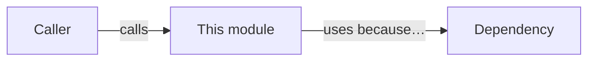

# [Logical module or ClassName] — Source Reference

> **Coverage:** Draft / Verified · **Source revision:** [commit or branch] · **Last checked:** [YYYY-MM-DD]
>
> **Files:** [`include/path/to/file.h`](../../include/path/to/file.h) and [`src/path/to/file.cpp`](../../src/path/to/file.cpp) (replace with REAL paths and omit missing files).

**In one sentence:** [In plain English: what problem this code solves.]

**Why it exists:** [Why the rest of the engine needs it.]

## At a glance

| This code… | Explanation |
| --- | --- |
| Is responsible for | [Specific job] |
| Gets information from | [Inputs, owners, other modules] |
| Changes | [State, resources, scene, screen, events] |
| Used by | [Specific callers, with links to their documentation] |
| Depends on | [Other project modules, SDL or standard library as relevant] |

## Contents — jump to an explanation

| Symbol | What it means | Jump |
| --- | --- | --- |
| `[ClassName]` | [One-line class role] | [Class](#class-classname) |
| `[ClassName::method(...)]` | [One-line action] | [Function](#classname-method) |
| `[helper(...)]` | [One-line action] | [Function](#helper) |
| `[constant / enum / field]` | [One-line role] | [State & types](#state-and-types) |

## Class: `[ClassName]`

**Purpose:** [What one instance represents; where it fits in the engine.]

**How it's created and destroyed:** [Constructor(s), ownership, lifespan and cleanup; distinguish owning smart pointers from non-owning references.]

**Parent class / interface:** [If any; meaning of inherited virtual functions.]

**Important rules (invariants):** [What must always remain true; e.g., a pointer may be null only before init. Only state facts verified in code.]

### Fields

| Field | Type / initial value | Meaning and units | Who changes it / ownership |
| --- | --- | --- | --- |
| `[member]` | `[type, default]` | [Plain-English purpose] | [Which methods write; owning/non-owning] |

### Construction and cleanup

Explain **every** constructor, destructor, copy/move operation and custom operator, even if trivial. Link their entries below or state explicitly when compiler-generated and why that matters.

## Functions

> Duplicate the following block for **each** constructor, method, free function, operator, template and private helper. Include overloads separately. **Never skip one because it is short.**

### `[ClassName::method(Type parameter, ...)]`

**What it does:** [One clear sentence explaining its result.]

**Why/when it's used:** [Who typically calls it, and under what condition.]

**Defined in:** [`real_source_file.cpp`](../../src/real_source_file.cpp) · **Declared in:** [`real_header.h`](../../include/real_header.h) (replace with verified locations).

**Parameters**

| Name | Type | What the caller supplies | Rules / units |
| --- | --- | --- | --- |
| `parameter` | `Type` | [Meaning] | [Allowed values, nullable?, ownership, seconds/pixels/etc.] |

**Returns:** `[ReturnType]` — [What value means; for `void`, say "Nothing; effect is ...". If a reference/pointer, explain its lifetime/nullability.]

**What happens, in order**

1. [Important step and condition; explain the reason.]
2. [Important step and any state it changes.]
3. [How it finishes, including early returns.]

**Calls other project functions**

| Calls | Why this call is needed here | Where to find it |
| --- | --- | --- |
| `OtherClass::doThing(...)` | [Specific purpose at this point] | [Read function](other-file.md#otherclass-dothing) |

If none, explicitly write **No direct project-function calls.** Explain meaningful SDL/third-party calls separately if they are essential to understanding the behavior; no need to list every trivial standard-library operation.

**Changes or side effects:** [Fields modified; files written; events fired; resources created/destroyed; logging; drawing; none if pure.]

**Errors and edge cases:** [Throws, return-on-failure, invalid input, missing components, empty collections, null pointers, re-entrancy, cleanup. Use facts from implementation.]

**Used by:** [Link callers to their documentation anchors; include important tests.]

**Related tests:** [Link test pages + specific test anchor.]

## State and types

Give each enum, constant and standalone named variable its own unique anchor in the name cell, so the symbol index can link to the exact entry.

Use this section for free-standing enums (list every value), aliases, constants, macros, static/global variables and important local variables. For trivial loop variables, explain their role in the relevant function walkthrough instead of creating several empty table rows.

| Name | Kind / type | Value or initialization | What it means / where used |
| --- | --- | --- | --- |
| `[name]` | `enum / constexpr / local / global …` | `[actual value]` | [Plain-English role and units; link relevant functions] |

## Dependencies and interactions

**Includes / external libraries that matter:** [Why needed, rather than just copying the include list.]

**Project dependencies:** [Links to related file pages. Clarify which layer owns what.]

**Mini-diagram (optional; replace with actual relationships)**

## Things worth knowing

- **Assumptions:** [What this code assumes before it runs.]
- **Surprising behavior:** [Side effects, costs, edge cases, hidden coupling.]
- **Needs verification:** [Only unresolved source questions. Remove if none.]

**Back to:** [Code index](index.md) · [Symbol index](symbol-index.md)
