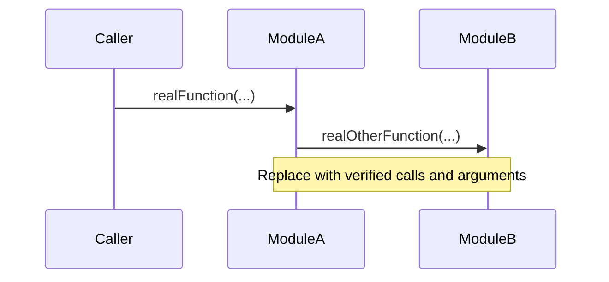

# [Workflow Name] — How It Works

> **Coverage:** Draft / Verified · **Checked against:** [branch/commit]

**In one sentence:** [What the whole sequence accomplishes.]

**Why this path matters:** [Why a contributor needs to know it.]

## Flow diagram

## Walkthrough

| # | Function that runs | Why it runs | What changes / result |
| --- | --- | --- | --- |
| 1 | [Deep link to actual caller](../code/real-a.md#caller) | [Reason] | [Change] |
| 2 | [Deep link to callee](../code/real-b.md#callee) | [Reason] | [Return/state] |

## Ownership and state

[Who owns each important object/resource? When is it released or replaced? What assumptions keep the path safe?]

## Alternatives and exits

[Early return, null/error path, failure cleanup, event/callback paths.]

## What to read next

[Links to exact code pages, tests, architecture overview.]
