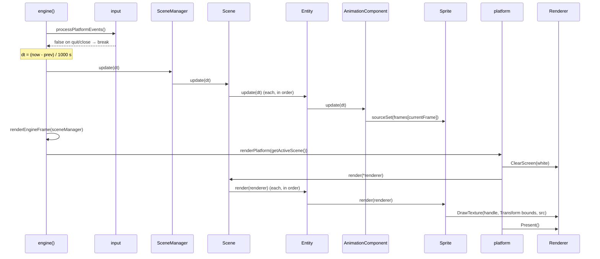

# A Frame in the Engine

> **Coverage:** Verified · **Checked against:** `feature/phase3-animation` @ `6749cec`

**In one sentence:** Each loop iteration reads events, computes `dt`, updates the active scene (advancing animations), and draws it.

## Flow diagram

## Walkthrough

| # | Function that runs | Why it runs | What changes / result |
| --- | --- | --- | --- |
| 1 | [`processPlatformEvents`](../code/input.md#processplatformevents) | Read OS events | Pressed/released arrays; returns false to stop |
| 2 | (inline in [`engine`](../code/engine.md#engine)) | Frame-rate-independent timing | `delta_time` in seconds |
| 3 | [`SceneManager::update`](../code/scene-manager.md#scenemanager-update) | Advance game state | Calls the scene, or nothing if none is active |
| 4 | [`Scene::update`](../code/scene.md#scene-update) → [`Entity::update`](../code/entity.md#entity-update) | Reach every component | Creation order |
| 5 | [`AnimationComponent::update`](../code/animation-component.md#animationcomponent-update) | Advance the animation clock | Picks a frame; calls [`Sprite::sourceSet`](../code/sprite.md#sprite-sourceset) |
| 6 | [`renderEngineFrame`](../code/engine.md#renderengineframe) → [`renderPlatform`](../code/platform.md#renderplatform) | Draw | Clears to white |
| 7 | [`Scene::render`](../code/scene.md#scene-render) → [`Entity::render`](../code/entity.md#entity-render) → [`Sprite::render`](../code/sprite.md#sprite-render) | Each sprite draws itself | [`DrawTexture`](../code/renderer.md#renderer-drawtexture) with dest = Transform, src = current frame |
| 8 | [`Renderer::Present`](../code/renderer.md#renderer-present) | Show the frame | Waits for vsync |

## Important ordering facts

- **Update before render**, so the first frame drawn already has the animation's frame 0.
- **Creation order = draw order.** Later entities appear on top.
- **Vsync** in `Present()` paces the loop to the display refresh rate.

## Error and exit paths

| Situation | What happens |
| --- | --- |
| Quit or close event | The loop `break`s; the scene is destroyed at the end of the scope; `shutdownPlatform()` |
| Platform start-up fails | `engine()` logs an Error and returns (the platform already cleaned up) |
| No active scene during render | `getActiveScene` throws `std::runtime_error` (can't happen in the current demo) |
| Bad texture handle / bad source rect | Logged warning; that sprite isn't drawn; the loop continues |
| Missing asset during set-up | `std::runtime_error` escapes `engine()`; no shutdown |

## Related code

[Symbol index](../code/symbol-index.md) · [Architecture overview](index.md) · [Ownership](ownership.md) · [Tests](../tests/index.md)
