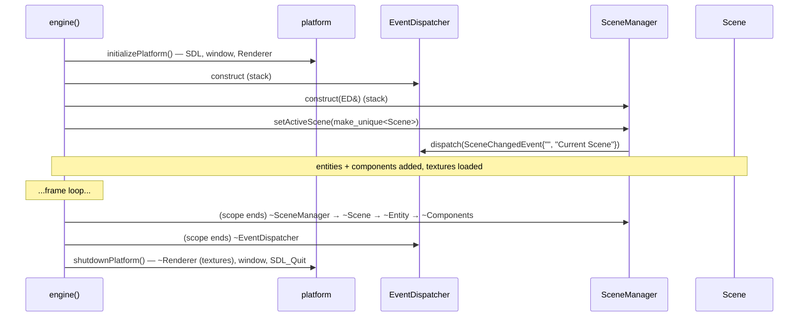

# Ownership and Lifetime — How It Works

> **Coverage:** Verified · **Checked against:** `feature/phase3-animation` @ `6749cec`

**In one sentence:** Things are created in the order platform → dispatcher → manager → scene → entities → components, and destroyed in the reverse order, so nothing points at something already gone.

**Why this path matters:** Most C++ crashes come from using an object after its owner freed it. This page shows why the current order is safe, and what new code must respect.

## Flow diagram

## Walkthrough

| # | Function that runs | Why it runs | What changes / result |
| --- | --- | --- | --- |
| 1 | [`initializePlatform`](../code/platform.md#initializeplatform) | Everything else needs a renderer | SDL, window and `Renderer` exist |
| 2 | `EventDispatcher` ctor | The manager needs it | Declared **first**, so it's destroyed **last** |
| 3 | [`SceneManager` ctor](../code/scene-manager.md#scenemanager-scenemanager) | Holds the active scene | Borrows the dispatcher |
| 4 | [`setActiveScene`](../code/scene-manager.md#scenemanager-setactivescene) | Install the scene | Old scene (none) destroyed; event sent |
| 5 | [`createEntity`](../code/scene.md#scene-createentity) / [`addComponent`](../code/entity.md#entity-addcomponent) | Build the demo | Scene owns entities; entities own components |
| 6 | End of `{ }` in [`engine`](../code/engine.md#engine) | Scene objects must die before the renderer | Components → entities → scene → manager → dispatcher |
| 7 | [`shutdownPlatform`](../code/platform.md#shutdownplatform) | Release SDL | Textures → renderer → window → SDL |

## Ownership and state

- **Textures vs sprites:** sprites store a [`textureHandle`](../code/render-types.md#rendertypes-texturehandle) (a number). The [Renderer](../code/renderer.md#renderer-textures) owns the actual `SDL_Texture*`. Textures stay loaded for the whole run (**retained**, never unloaded early).
- **Back-pointers:** `Component::owner` is safe because entities can't be copied or moved, and components die with their entity.
- **Events carry copies:** `SceneChangedEvent` holds `std::string` copies, so the names survive the old scene's destruction.

## Rules for new code

1. Anything holding a `Renderer&`, an `SDL_*` pointer or a texture **pointer** must be destroyed **inside** the `engine()` scope, before `shutdownPlatform()`.
2. Anything holding an `EventDispatcher&` must be declared **after** the dispatcher.
3. Don't keep `Entity&` or `Component*` across a scene switch, because the old scene's objects are destroyed by `setActiveScene`.

## Alternatives and exits

- Start-up failure: nothing beyond the platform was created, and the platform cleaned itself up.
- An exception thrown during scene set-up skips both the end of scope and `shutdownPlatform()`. Stack unwinding still destroys the locals, but SDL isn't shut down cleanly.

## What to read next

[Architecture overview](index.md) · [Frame flow](frame-flow.md) · [Platform](../code/platform.md) · [SceneManager tests](../tests/test-scene.md)
