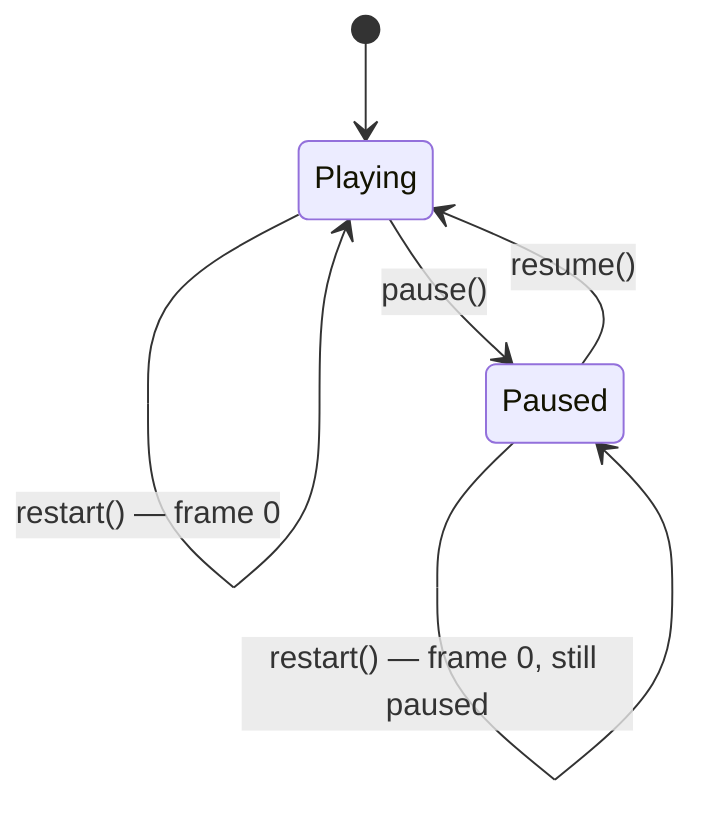
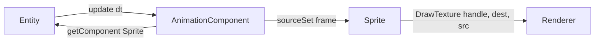

# AnimationComponent — Source Reference

> **Coverage:** Verified · **Source revision:** `feature/phase3-animation` @ `6749cec` · **Last checked:** 2026-10-31
>
> **Files:** [`include/ecs/animationComponent.h`](../../include/ecs/animationComponent.h) and [`src/ecs/animationComponent.cpp`](../../src/ecs/animationComponent.cpp).

**In one sentence:** Flips through a list of rectangles on a sprite sheet at a fixed speed, telling the entity's [`Sprite`](sprite.md) which rectangle to draw.

**Why it exists:** It gives frame-based animation from **one** image file. The image holds all frames side by side, and the component chooses which part (the **source rectangle**) to show each frame.

## At a glance

| This code… | Explanation |
| --- | --- |
| Is responsible for | Animation timing and picking the current frame |
| Gets information from | `dt` from [Entity::update](entity.md#entity-update); its own frame list |
| Changes | Its timing state; the sibling Sprite's source rectangle |
| Used by | [engine demo](engine.md#engine) (entity 3) |
| Depends on | [Component](component.md), [Entity](entity.md), [Sprite](sprite.md), [Bounds](render-types.md#struct-bounds) |

## Contents

| Symbol | What it means | Jump |
| --- | --- | --- |
| `AnimationComponent` | Sprite-sheet animator | [Class](#class-animationcomponent) |
| Constructor | Validate and store frames | [Function](#animationcomponent-animationcomponent) |
| `update(float)` | Advance time and choose a frame | [Function](#animationcomponent-update) |
| `pause()` / `resume()` | Freeze / unfreeze | [pause](#animationcomponent-pause) · [resume](#animationcomponent-resume) |
| `restart()` | Back to frame 0 | [Function](#animationcomponent-restart) |

## How the timing works (plain English)

Think of a flip-book:

- `duration` is **how long each page stays up** (seconds per frame).
- `dt` is **how much time passed since the last update**.
- `elapsed` is **how long the current page has been up so far**.

Each update adds `dt` to `elapsed`. While `elapsed` is at least `duration`, it turns one page and subtracts `duration`. The **leftover** stays in `elapsed`, so timing doesn't drift. If a frame took a long time (big `dt`), the `while` loop can turn several pages at once.

Example: `duration = 0.25`, updates of `0.1` s → pages turn after the 3rd update (0.3), leaving 0.05.

## Class: `AnimationComponent`

**Parent class:** [`Component`](component.md#class-component); overrides `update`.

**How it's created:** `entity.addComponent<AnimationComponent>(frames, secondsPerFrame, loop)`. The entity must also have a `Sprite` for anything to show.

**Important rules:** `frames` is never empty, and `duration` is a positive finite number (both enforced by the constructor). `currentFrame < frames.size()`.

### Fields

| Field | Type / initial value | Meaning and units | Who changes it |
| --- | --- | --- | --- |
| `frames` | `std::vector<Bounds>` | Source rectangles, in **texture pixels**, in play order | Constructor (a copy) |
| `duration` | `float`, `0.0f` | **Seconds per frame** (not total length) | Constructor |
| `repeat` | `bool`, `true` | `true`: loop to frame 0. `false`: stop on the last frame. | Constructor |
| `currentFrame` | `std::size_t`, `0` | Index of the frame being shown | `update`, `restart` |
| `elapsed` | `float`, `0.0f` | Seconds spent on the current frame | `update`, `restart` |
| `paused` | `bool`, `false` | When true, `update` does nothing | `pause`, `resume` |

## Functions

### `AnimationComponent::AnimationComponent(const std::vector<Bounds>& newFrames, float newDuration, bool newRepeat)`

**What it does:** Checks the input, then stores it.

| Name | Type | What the caller supplies | Rules / units |
| --- | --- | --- | --- |
| `newFrames` | `const std::vector<Bounds>&` | Frame rectangles | Not empty. Each must fit inside the sprite's texture, or `DrawTexture` will reject it at draw time. |
| `newDuration` | `float` | Seconds per frame | `> 0` and finite (not `inf`/`NaN`) |
| `newRepeat` | `bool` | Loop or hold the last frame | — |

**Errors:**

- `std::invalid_argument("Empty frames")` if `newFrames` is empty.
- `std::invalid_argument("Invalid duration")` if `newDuration <= 0` or not finite.

Because `addComponent` constructs the component before attaching it, a throw here leaves the entity unchanged.

**No direct project-function calls.**

### `void AnimationComponent::update(float dt)` (override)

**What it does:** Advances the animation by `dt` seconds and pushes the current frame rectangle into the sibling `Sprite`.

**What happens, in order**

1. If `paused`, it returns immediately (time does **not** build up while paused).
2. `elapsed += dt`.
3. `while (elapsed >= duration)`: subtracts `duration` and advances `currentFrame`. Past the end, it goes to `0` if `repeat` is true; otherwise it stays on the last frame.
4. Gets the owner with [`getOwner()`](component.md#component-getowner). If null, it returns.
5. Finds the [`Sprite`](sprite.md) with [`getComponent<Sprite>()`](entity.md#entity-getcomponent). If missing, it returns.
6. Calls [`sprite->sourceSet(frames[currentFrame])`](sprite.md#sprite-sourceset).

**Calls other project functions**

| Calls | Why this call is needed here | Where |
| --- | --- | --- |
| `Component::getOwner` | Reach the entity | [getOwner](component.md#component-getowner) |
| `Entity::getComponent<Sprite>` | Find what to animate | [getComponent](entity.md#entity-getcomponent) |
| `Sprite::sourceSet` | Tell the sprite which rectangle to draw | [sourceSet](sprite.md#sprite-sourceset) |

**Side effects:** changes `elapsed`, `currentFrame`, and the Sprite's `src` (every update, even if the frame didn't change).

**Edge cases:**

- **Non-looping:** after reaching the last frame, `elapsed` keeps cycling, but the frame stays the last one.
- **`dt` = NaN:** `elapsed` becomes NaN, the `while` never runs, and the animation freezes. The engine never passes NaN.
- **Negative `dt`:** reduces `elapsed`, but never goes back a frame.
- **Very large `dt`:** the loop runs `dt / duration` times. That's fine for normal frame times.

### `void AnimationComponent::pause()`

Sets `paused = true`. The current frame stays visible. **No direct project-function calls.**

### `void AnimationComponent::resume()`

Sets `paused = false`. It continues from where it stopped, with no jump. **No direct project-function calls.**

### `void AnimationComponent::restart()`

Sets `currentFrame = 0` and `elapsed = 0`. **It doesn't change `paused`.** The Sprite only receives frame 0 on the **next** `update` (and not while paused). **No direct project-function calls.**

## Dependencies and interactions

The dependency goes **one way** (AnimationComponent → Sprite). `Sprite` doesn't include or know about animation.

## Things worth knowing

- **Shared textures:** two entities can use the same texture handle and still animate independently, because each has its own `AnimationComponent` state.
- **Before the first `update`:** the Sprite's `src` is empty, so the **whole** sheet would be drawn. The engine updates before rendering, so you never see this.
- **Tests:** no `AnimationComponent` tests exist yet. Timing tests are assigned to Yassmine (team convention: the other developer writes the tests).

**Back to:** [Code index](index.md) · [Symbol index](symbol-index.md)
