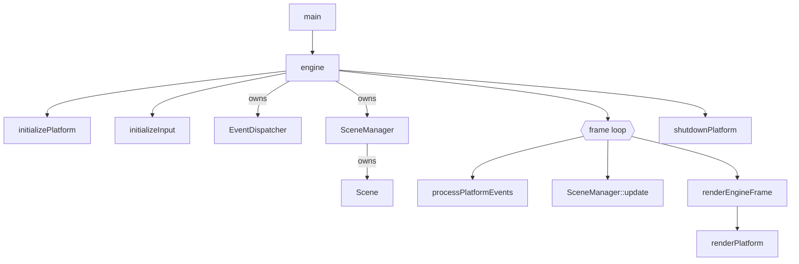

# Engine loop — Source Reference

> **Coverage:** Verified · **Source revision:** `feature/phase3-animation` @ `6749cec` · **Last checked:** 2026-10-31
>
> **Files:** [`include/core/engine.h`](../../include/core/engine.h), [`src/core/engine.cpp`](../../src/core/engine.cpp) and [`src/main.cpp`](../../src/main.cpp).

**In one sentence:** `engine()` starts the platform, builds the demo scene, runs the input → update → render loop until the window closes, then shuts down.

**Why it exists:** It is the heart of the program. It decides **the order** in which things happen each frame and **how long** objects live.

## At a glance

| This code… | Explanation |
| --- | --- |
| Is responsible for | Start-up, demo scene construction, the frame loop, delta time, shutdown |
| Gets information from | The platform (events), the system clock |
| Changes | Creates the `EventDispatcher`, `SceneManager` and active `Scene`; drives everything |
| Used by | [`main`](#main), [EngineTest](../tests/test-engine.md) |
| Depends on | [platform](platform.md), [input](input.md), [logger](logger.md), [SceneManager](scene-manager.md), [Scene](scene.md), [Entity](entity.md), [Transform](transform.md), [Sprite](sprite.md), [AnimationComponent](animation-component.md) |

## Contents — jump to an explanation

| Symbol | What it means | Jump |
| --- | --- | --- |
| `main()` | Program entry point | [Function](#main) |
| `engine()` | Whole engine lifetime | [Function](#engine) |
| `renderEngineFrame(SceneManager&)` | Draw the active scene | [Function](#renderengineframe) |

## Functions

### `int main()`

**What it does:** Calls [`engine()`](#engine), then returns `0`.

**Defined in:** [`src/main.cpp`](../../src/main.cpp). It includes `<SDL3/SDL.h>` and `<iostream>` without using them.

**Errors:** It always returns 0, even if the engine failed to start. An uncaught exception from `engine()` ends the program abnormally.

### `void renderEngineFrame(SceneManager& sceneManager)`

**What it does:** Gets the active scene and asks the platform to draw it.

| Name | Type | What the caller supplies | Rules |
| --- | --- | --- | --- |
| `sceneManager` | `SceneManager&` | The manager holding the active scene | Must have an active scene |

**Calls other project functions**

| Calls | Why | Where |
| --- | --- | --- |
| `SceneManager::getActiveScene` | Find what to draw | [getActiveScene](scene-manager.md#scenemanager-getactivescene) |
| `renderPlatform` | Clear, draw scene, present | [renderPlatform](platform.md#renderplatform) |

**Errors:** Throws `std::runtime_error` if no scene is active (from `getActiveScene`).

### `void engine()`

**What it does:** Runs the whole engine from start to finish.

**Returns:** Nothing. It returns early if start-up fails.

**What happens, in order**

1. **Start-up.** `running = initializePlatform()`. If that worked, it calls `initializeInput()`. If not, it logs Error `Error occured while initializing engine` and returns. Nothing needs cleaning up, because the platform already cleaned itself.
2. **Clock.** Records `prev_time` as milliseconds from `std::chrono::steady_clock`.
3. **Inner scope `{ … }`** (this matters for lifetime; see below):
    1. Creates an `EventDispatcher`, then a `SceneManager` that **borrows** it.
    2. Sets the active scene to a new `Scene("Current Scene")`, which dispatches one `SceneChangedEvent` (no listeners yet).
    3. **Builds the demo:**
        - Entity 1: `Transform` (100, 150, 50×50) + `Sprite` with `assets/test.bmp`.
        - Entity 2: `Transform` (200, 300, 50×50) + `Sprite` with `assets/test.bmp` (loaded again, so a second texture).
        - Entity 3: `Transform` (300, 150, 32×32) + `Sprite` with `assets/anim_sheet.bmp` + `AnimationComponent` with 4 frames of 32×32 at x = 0, 32, 64, 96, 0.25 s each, looping.
    4. **Frame loop** (`while (running)`):
        1. Reads the time (`current_time`).
        2. `running = processPlatformEvents()`. On quit/close, it `break`s.
        3. `delta_time = (current_time - prev_time) / 1000.0f`, in **seconds**.
        4. `sceneManager.update(delta_time)` updates every entity and component (this is where animations advance).
        5. `renderEngineFrame(sceneManager)` draws.
        6. `prev_time = current_time`.
4. **Leaving the scope** destroys `sceneManager` (and with it the scene, entities and components), then `eventDispatcher`.
5. **Shutdown.** `shutdownPlatform()`.

**Calls other project functions**

| Calls | Why this call is needed here | Where to find it |
| --- | --- | --- |
| `initializePlatform` | Start SDL, window, renderer | [initializePlatform](platform.md#initializeplatform) |
| `initializeInput` | Get SDL's keyboard-state array (needs SDL running) | [initializeInput](input.md#initializeinput) |
| `logMessage` | Report start-up failure | [logMessage](logger.md#logmessage) |
| `SceneManager::SceneManager` | Create the scene owner, borrowing the dispatcher | [Constructor](scene-manager.md#scenemanager-scenemanager) |
| `SceneManager::setActiveScene` | Give the manager its first scene | [setActiveScene](scene-manager.md#scenemanager-setactivescene) |
| `SceneManager::getActiveScene` | Access the scene to add entities | [getActiveScene](scene-manager.md#scenemanager-getactivescene) |
| `Scene::createEntity` | Make each demo entity | [createEntity](scene.md#scene-createentity) |
| `Entity::addComponent<T>` | Attach Transform / Sprite / AnimationComponent | [addComponent](entity.md#entity-addcomponent) |
| `loadPlatformTexture` | Load BMPs for the sprites | [loadPlatformTexture](platform.md#loadplatformtexture) |
| `processPlatformEvents` | Handle input and detect quit | [processPlatformEvents](input.md#processplatformevents) |
| `SceneManager::update` | Advance game state by `delta_time` | [update](scene-manager.md#scenemanager-update) |
| `renderEngineFrame` | Draw the frame | [renderEngineFrame](#renderengineframe) |
| `shutdownPlatform` | Release everything | [shutdownPlatform](platform.md#shutdownplatform) |

### Local variables

| Name | Type | Meaning |
| --- | --- | --- |
| `running` | `bool` | Start-up result; then "keep looping" |
| `delta_time` | `float` | Seconds since the previous frame (millisecond resolution) |
| `prev_time`, `current_time` | `auto` (`long long` ms) | Clock readings for delta time |
| `eventDispatcher` | `EventDispatcher` | Event hub; must outlive `sceneManager` |
| `sceneManager` | `SceneManager` | Owns the active scene |
| `sceneEntity`, `sceneEntity2`, `sceneEntity3` | `Entity&` | Borrowed references to demo entities (owned by the scene) |
| `transformComponent…3` | `Transform&` | Borrowed references used to set positions |
| `handle`, `handle2`, `handle3` | `textureHandle` | Texture IDs for the sprites |
| `frames` | `std::vector<Bounds>` | The 4 source rectangles, copied into the `AnimationComponent` |

**Why the inner `{ }` scope matters (lifetime ordering):**

- `eventDispatcher` is declared **before** `sceneManager`, so it's destroyed **after** it. `SceneManager` holds a reference to it, so that order is required.
- The scene and its sprites are destroyed **before** `shutdownPlatform()` destroys the renderer. Sprites only hold texture **handles** (numbers), so nothing dangles. But anything added later that holds a `Renderer&` or SDL pointer must also die inside this scope.

**Errors and edge cases:**

- If `loadPlatformTexture` throws (missing asset), the exception leaves `engine()` uncaught, so `shutdownPlatform()` never runs.
- The first `delta_time` includes the scene set-up time (texture loading), so the first animation step may skip ahead.
- `delta_time` has **millisecond** resolution because of `duration_cast<milliseconds>`.
- `update` runs **before** `render`, so the animated sprite already has frame 0 set on the very first draw.

**Related tests:** [EngineTest](../tests/test-engine.md).

## Dependencies and interactions

## Things worth knowing

- `engine.h` has **no `#pragma once`**.
- `engine.cpp` includes `game.h`, `render_api.h`, `<SDL3/SDL.h>`, `<array>`, `<iostream>` and `<string>` but doesn't use them.
- `using namespace std;` is at file scope.
- The demo scene is **hard-coded**. The Phase 3 serializer ticket will let it come from a JSON file instead.

**Back to:** [Code index](index.md) · [Symbol index](symbol-index.md)
