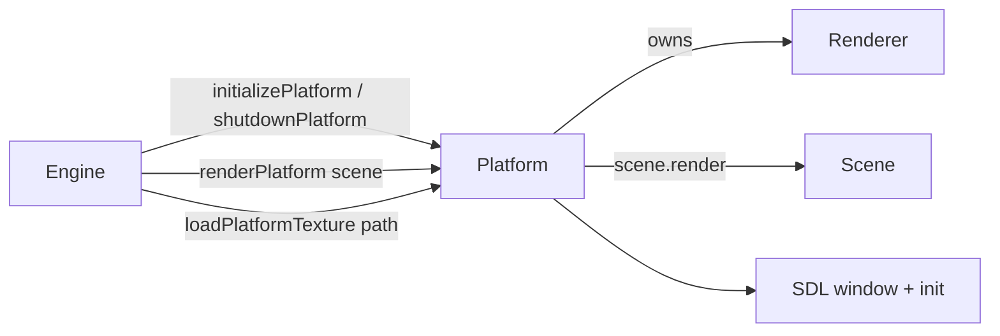

# Platform — Source Reference

> **Coverage:** Verified · **Source revision:** `feature/phase3-animation` @ `6749cec` · **Last checked:** 2026-10-31
>
> **Files:** [`include/platform/platform.h`](../../include/platform/platform.h) and [`src/platform/platform.cpp`](../../src/platform/platform.cpp). This `.cpp` also implements the functions declared in [`render_api.h`](render-api.md).

**In one sentence:** Starts and stops SDL, owns the window and the one engine [`Renderer`](renderer.md), and gives the engine simple functions to draw a scene and load textures.

**Why it exists:** It keeps window/SDL set-up and tear-down in one place, so the engine loop ([`engine`](engine.md#engine)) never touches SDL objects directly. It also guarantees clean-up on every failure path.

## At a glance

| This code… | Explanation |
| --- | --- |
| Is responsible for | SDL start/stop, window, the global `Renderer`, frame drawing entry points |
| Gets information from | The engine (scene to draw, texture paths) |
| Changes | Global `window`, `renderer`, `currentTexture`; the screen |
| Used by | [engine](engine.md), [game](game.md) (via render API), tests |
| Depends on | SDL3, [Renderer](renderer.md), [logger](logger.md), [Scene](scene.md) |

## Contents — jump to an explanation

| Symbol | What it means | Jump |
| --- | --- | --- |
| `window` | The SDL window (global) | [State](#platform-window) |
| `renderer` | The engine's Renderer (global) | [State](#platform-renderer) |
| `currentTexture` | Texture loaded at start-up for the old render API | [State](#platform-currenttexture) |
| `initializePlatform()` | Start SDL, window, renderer | [Function](#initializeplatform) |
| `shutdownPlatform()` | Destroy everything, quit SDL | [Function](#shutdownplatform) |
| `renderPlatform(Scene&)` | Draw one frame of a scene | [Function](#renderplatform) |
| `loadPlatformTexture(const char*)` | Load a texture via the global renderer | [Function](#loadplatformtexture) |
| `beginFrame()` | Old API: clear to black | [Function](#beginframe) |
| `drawFilledRect(Color, Bounds)` | Old API: draw rectangle | [Function](#drawfilledrect) |
| `drawTexture()` | Old API: draw start-up texture | [Function](#drawtexture) |
| `presentFrame()` | Old API: present | [Function](#presentframe) |

## State and types

These are **file-level globals** (not `static`, so they have external linkage).

| Name | Kind / type | Value or initialization | What it means / where used |
| --- | --- | --- | --- |
| `window` | global `SDL_Window*` | `nullptr` | The game window. Created in [`initializePlatform`](#initializeplatform), destroyed in [`shutdownPlatform`](#shutdownplatform) or on a failure path. Owning raw pointer. |
| `renderer` | global `std::unique_ptr<Renderer>` | `nullptr` | The engine's only [`Renderer`](renderer.md#class-renderer). All drawing goes through it. `nullptr` means "not initialised", and most functions check this. |
| `currentTexture` | global `textureHandle` | `0` | Handle of `assets/test.bmp`, loaded during start-up. Only used by the Phase 1 [`drawTexture`](#drawtexture). Not reset by shutdown. |

## Functions

### `bool initializePlatform()`

**What it does:** Starts SDL video and audio, opens an 800×600 window, creates the [`Renderer`](renderer.md#renderer-renderer), and loads `assets/test.bmp`.

**Why/when it's used:** First thing in [`engine`](engine.md#engine). Tests call it directly.

**Returns:** `bool`. `true` means everything is ready; `false` means start-up failed and **everything was cleaned up already**.

**What happens, in order**

1. `SDL_Init(SDL_INIT_VIDEO | SDL_INIT_AUDIO)`. If it fails, it logs an Error and returns `false`.
2. Logs `SDL3 initialized successfully!`.
3. `SDL_CreateWindow("My SDL3 Window", 800, 600, SDL_WINDOW_OPENGL)`. If it fails, it logs an Error, calls `SDL_Quit()` and returns `false`.
4. Logs `Window created successfully!`.
5. Inside `try`:
    1. Creates the renderer with `std::make_unique<Renderer>(window)`.
    2. Gets the executable folder with `SDL_GetBasePath()`. If null, it throws.
    3. Builds `<basePath>assets/test.bmp` and loads it into `currentTexture`.
6. `catch (const std::runtime_error&)`: logs the message, resets the renderer, destroys the window, sets `window = nullptr`, calls `SDL_Quit()` and returns `false`.
7. Returns `true`.

**Calls other project functions**

| Calls | Why this call is needed here | Where to find it |
| --- | --- | --- |
| `logMessage` | Report each step's success or failure | [logMessage](logger.md#logmessage) |
| `Renderer::Renderer` (via `make_unique`) | Create the drawing object | [Renderer constructor](renderer.md#renderer-renderer) |
| `Renderer::LoadTexture` | Load the start-up texture for `drawTexture` | [LoadTexture](renderer.md#renderer-loadtexture) |

**Side effects:** Starts SDL, opens a window, sets the three globals, and logs.

**Errors and edge cases:**

- Every failure path undoes what was already done, so `SDL_WasInit(0) == 0` after a `false` return. Tests check this.
- Only `std::runtime_error` is caught. Other exception types would escape without clean-up.
- A missing `assets/test.bmp` next to the executable makes start-up fail.

**Used by:** [`engine`](engine.md#engine).

**Related tests:** [PlatformTest](../tests/test-platform.md) (all), [EngineTest](../tests/test-engine.md) failure tests.

### `void shutdownPlatform()`

**What it does:** Destroys the renderer, then the window, then quits SDL.

**Why/when it's used:** At the end of [`engine`](engine.md#engine). Tests also call it before and after each test.

**What happens, in order**

1. `renderer.reset()` runs [`~Renderer`](renderer.md#renderer-destructor), which frees textures and the SDL renderer.
2. If `window` isn't null, it destroys it and sets it to `nullptr`.
3. Logs `Engine is shutting down`.
4. `SDL_Quit()`.

**Calls other project functions**

| Calls | Why | Where |
| --- | --- | --- |
| `Renderer::~Renderer` (via `reset`) | Free GPU resources **before** the window disappears | [Destructor](renderer.md#renderer-destructor) |
| `logMessage` | Announce shutdown | [logMessage](logger.md#logmessage) |

**Errors and edge cases:** Safe to call before initialisation and safe to call twice. It logs "Engine is shutting down" every time, even if nothing was running. It doesn't reset `currentTexture`.

**Related tests:** [ShutdownIsSafeBeforeInitialization](../tests/test-platform.md#platformtest-shutdownissafebeforeinitialization), [ShutdownIsSafeWhenCalledTwice](../tests/test-platform.md#platformtest-shutdownissafewhencalledtwice).

### `void renderPlatform(Scene& scene)`

**What it does:** Draws one full frame of `scene`: it clears to white, lets the scene draw itself, then presents.

**Why/when it's used:** Every frame, via [`renderEngineFrame`](engine.md#renderengineframe). This is how the platform layer **delegates drawing to the active scene**.

| Name | Type | What the caller supplies | Rules |
| --- | --- | --- | --- |
| `scene` | `Scene&` | The scene to draw | Borrowed, not owned. Must be alive for the call. |

**What happens, in order**

1. If `renderer` is null, it logs Warning `Renderer is not initialized!` and returns.
2. `renderer->ClearScreen(Color{255,255,255,255})` clears to white.
3. `scene.render(*renderer)` hands every entity the renderer.
4. `renderer->Present()`.

**Calls other project functions**

| Calls | Why | Where |
| --- | --- | --- |
| `Renderer::ClearScreen` | Remove last frame | [ClearScreen](renderer.md#renderer-clearscreen) |
| `Scene::render` | Let entities/components draw themselves | [Scene::render](scene.md#scene-render) |
| `Renderer::Present` | Show the frame | [Present](renderer.md#renderer-present) |
| `logMessage` | Warn if called too early | [logMessage](logger.md#logmessage) |

### `textureHandle loadPlatformTexture(const char* filePath)`

**What it does:** Loads a BMP through the global renderer and returns its handle.

**Why/when it's used:** By [`engine`](engine.md#engine) when building the demo scene, so engine code never touches `Renderer` directly.

| Name | Type | What the caller supplies | Rules |
| --- | --- | --- | --- |
| `filePath` | `const char*` | Path to a BMP | **Passed straight through.** A relative path is relative to the **current working directory**. |

**Returns:** the new handle, or `0` if the renderer isn't initialised (and logs a Warning).

**Calls other project functions:** [`Renderer::LoadTexture`](renderer.md#renderer-loadtexture) to do the actual load, and [`logMessage`](logger.md#logmessage) for the warning.

**Errors and edge cases:**

- **Exceptions are not caught here.** A missing file throws `std::runtime_error` out of `engine()`, which isn't caught there either, so the program terminates without `shutdownPlatform`.
- **Path behaviour differs from `initializePlatform`:** `initializePlatform` prefixes `SDL_GetBasePath()` (the executable's folder), but this function does **not**. The demo works when launched from the repository root (`./build/bin/game_engine`), because `assets/` exists there. Launched from another folder, it fails.

### `void beginFrame()` (render API, Phase 1)

**What it does:** Clears the screen to **black** through the global renderer. If the renderer is null, it logs a Warning and returns.

**Calls:** [`Renderer::ClearScreen`](renderer.md#renderer-clearscreen), [`logMessage`](logger.md#logmessage). **Used by:** tests only ([CanRenderFrameThroughPublicRenderingApi](../tests/test-platform.md#platformtest-canrenderframethroughpublicrenderingapi)). The current engine loop uses [`renderPlatform`](#renderplatform) instead.

### `void drawFilledRect(Color rectColor, Bounds rectBounds)` (render API, Phase 1)

**What it does:** Forwards to [`Renderer::DrawFilledRect`](renderer.md#renderer-drawfilledrect). The comment says "center of the screen", but it actually draws wherever `rectBounds` says.

**Errors:** **There is no null check.** Calling it before `initializePlatform` dereferences a null `unique_ptr` (a crash).

**Used by:** [`renderGame`](game.md#rendergame), tests. (`game_tests` replaces it with a fake.)

### `void drawTexture()` (render API, Phase 1)

**What it does:** Draws the start-up texture ([`currentTexture`](#platform-currenttexture)) at x=100, y=100, 200×200, via [`Renderer::DrawTexture`](renderer.md#renderer-drawtexture).

**Errors:** No null check. **Used by:** tests only.

### `void presentFrame()` (render API, Phase 1)

**What it does:** Forwards to [`Renderer::Present`](renderer.md#renderer-present). No null check. **Used by:** tests only.

## Dependencies and interactions

**Includes that matter:** `platform.h` includes `scene.h` (so callers can pass a `Scene&`) and `rendertypes.h`. It forward-declares `Renderer`, so `platform.h` doesn't drag SDL into its users.

## Things worth knowing

- **Assumptions:** [`initializePlatform`](#initializeplatform) must succeed before the drawing functions are used.
- **Surprising behavior:** the old render API (`beginFrame`, `drawFilledRect`, `drawTexture`, `presentFrame`) is still compiled and tested, but the engine loop doesn't use it.
- **Needs verification:** decide whether `loadPlatformTexture` should prefix the base path like `initializePlatform` does. The Phase 3 AssetManager ticket ("Cache textures by asset-relative path") is expected to settle this.

**Back to:** [Code index](index.md) · [Symbol index](symbol-index.md)
