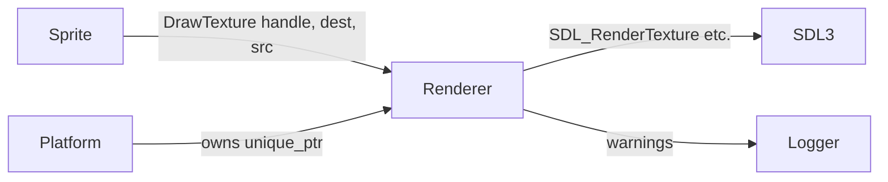

# Renderer — Source Reference

> **Coverage:** Verified · **Source revision:** `feature/phase3-animation` @ `6749cec` · **Last checked:** 2026-10-31
>
> **Files:** [`include/rendering/renderer.h`](../../include/rendering/renderer.h) and [`src/rendering/renderer.cpp`](../../src/rendering/renderer.cpp).

**In one sentence:** `Renderer` wraps an SDL renderer: it clears the screen, draws rectangles and textures, and owns every loaded texture.

**Why it exists:** It is the **only** class that talks to SDL's drawing functions. Everything else describes drawing with engine types ([`Color`](render-types.md#struct-color), [`Bounds`](render-types.md#struct-bounds), [`textureHandle`](render-types.md#rendertypes-texturehandle)), and `Renderer` turns those into SDL calls. Because it owns SDL resources, it also guarantees they are released (RAII).

## At a glance

| This code… | Explanation |
| --- | --- |
| Is responsible for | Creating/destroying the `SDL_Renderer`, loading BMP textures, drawing |
| Gets information from | An `SDL_Window*` (constructor); BMP files on disk; colours/rectangles from callers |
| Changes | The window's back buffer (what will be shown); its texture list |
| Used by | [platform](platform.md) (owns the one engine `Renderer`), [Sprite::render](sprite.md#sprite-render), [Scene::render](scene.md#scene-render) (passes it along), tests |
| Depends on | SDL3, [logger](logger.md), [render types](render-types.md) |

## Contents — jump to an explanation

| Symbol | What it means | Jump |
| --- | --- | --- |
| `Renderer` | Owner of the SDL renderer and textures | [Class](#class-renderer) |
| `Renderer(SDL_Window*)` | Creates the SDL renderer | [Function](#renderer-renderer) |
| `~Renderer()` | Frees textures, then the SDL renderer | [Function](#renderer-destructor) |
| `ClearScreen` | Fills the whole frame with one colour | [Function](#renderer-clearscreen) |
| `Present` | Shows the finished frame | [Function](#renderer-present) |
| `DrawFilledRect` | Draws a solid rectangle | [Function](#renderer-drawfilledrect) |
| `LoadTexture` | Loads a BMP and returns a handle | [Function](#renderer-loadtexture) |
| `DrawTexture` | Draws a texture, optionally only part of it | [Function](#renderer-drawtexture) |

## Class: `Renderer`

**Purpose:** One instance represents one SDL renderer attached to one window, plus every texture loaded through it.

**How it's created and destroyed:** Built with an existing `SDL_Window*`. In the running game, [`initializePlatform`](platform.md#initializeplatform) creates it inside a global `std::unique_ptr<Renderer>`, and [`shutdownPlatform`](platform.md#shutdownplatform) destroys it **before** the window. Tests also create local `Renderer` objects on the stack.

**Copying:** Copy constructor and copy assignment are **deleted** (two owners would both try to free the same SDL objects). Move operations are not declared, so they are also unavailable.

**Important rules (invariants):**

- After construction, `renderer` is never null (the constructor throws instead).
- `textures[0]` is always `nullptr`, so handle `0` means "no texture".
- A handle returned by `LoadTexture` stays valid until the `Renderer` is destroyed. Textures are never unloaded early.

### Fields

| Field | Type / initial value | Meaning and units | Who changes it / ownership |
| --- | --- | --- | --- |
| `renderer` | `SDL_Renderer*`, `nullptr` | The SDL renderer | Set by constructor; destroyed by destructor. **Owning** raw pointer. |
| `hasWarned` | `bool`, `false` | Whether the "Invalid texture handle" warning was already printed | Set to `true` once by `DrawTexture`; never reset |
| `textures` | `std::vector<SDL_Texture*>` | All loaded textures; **index = handle** | Slot 0 added by constructor; others appended by `LoadTexture`; freed by destructor. **Owning.** |

## Functions

### `Renderer::Renderer(SDL_Window* window)`

**What it does:** Creates an SDL renderer for `window`, turns on vsync, and reserves handle 0.

**Why/when it's used:** Once at platform start-up; also in tests.

**Parameters**

| Name | Type | What the caller supplies | Rules / units |
| --- | --- | --- | --- |
| `window` | `SDL_Window*` | The window to draw into | Not owned. Must outlive the `Renderer`. `nullptr` makes SDL fail, so the constructor throws. |

**Returns:** Nothing (constructor).

**What happens, in order**

1. Calls `SDL_CreateRenderer(window, nullptr)` (SDL picks the driver, which hints can override).
2. If that returns null, throws `std::runtime_error("Renderer error: " + SDL error)`.
3. Logs `Renderer is initialized` at Info level.
4. Calls `SDL_SetRenderVSync(renderer, 1)` so `Present` waits for the screen refresh. The result isn't checked.
5. Pushes `nullptr` into `textures` to reserve handle 0.

**Calls other project functions**

| Calls | Why this call is needed here | Where to find it |
| --- | --- | --- |
| `logMessage(Info, …)` | Report successful creation | [logMessage](logger.md#logmessage) |

**Changes or side effects:** Creates an SDL renderer; prints one log line.

**Errors and edge cases:** Throws `std::runtime_error` on failure. Nothing needs cleaning up in that case, because nothing was created.

**Used by:** [`initializePlatform`](platform.md#initializeplatform).

**Related tests:** [RendererTest.CreatesRendererForValidWindow](../tests/test-renderer.md#renderertest-createsrendererforvalidwindow), [RendererTest.RejectsNullWindow](../tests/test-renderer.md#renderertest-rejectsnullwindow).

### `Renderer::~Renderer()`

**What it does:** Destroys every loaded texture, then the SDL renderer.

**What happens, in order**

1. Loops `i` from the last index **down to 1** (slot 0 is the reserved null), and calls `SDL_DestroyTexture` on each non-null texture, setting the slot to `nullptr`.
2. Calls `SDL_DestroyRenderer(renderer)`.

**Calls other project functions:** **No direct project-function calls.**

**Changes or side effects:** Frees GPU/SDL memory. Afterwards, `SDL_GetRenderer(window)` returns null and the window can get a new renderer.

**Errors and edge cases:** The loop counter is an `int` initialised from `textures.size() - 1` (a `size_t`). Fine for realistic counts.

**Related tests:** [ReleasesRendererWhenItGoesOutOfScope](../tests/test-renderer.md#renderertest-releasesrendererwhenitgoesoutofscope), [DestroysRendererWithMultipleLoadedTextures](../tests/test-renderer.md#texturetest-destroysrendererwithmultipleloadedtextures).

### `void Renderer::ClearScreen(const Color& color)`

**What it does:** Fills the whole drawing area with `color`.

**Why/when it's used:** At the start of each frame, so last frame's pixels don't remain.

| Name | Type | What the caller supplies | Rules / units |
| --- | --- | --- | --- |
| `color` | `const Color&` | Background colour | 0–255 per channel |

**Returns:** `void`. Effect: the back buffer is one solid colour.

**What happens:** `SDL_SetRenderDrawColor` with the four channels, then `SDL_RenderClear`.

**Calls other project functions:** **No direct project-function calls.**

**Side effects:** Changes SDL's current draw colour (later draws that don't set a colour would use it).

**Used by:** [`renderPlatform`](platform.md#renderplatform) (white), [`beginFrame`](platform.md#beginframe) (black).

**Related tests:** [ClearScreenFillsEntireDrawingAreaWithRequestedColor](../tests/test-renderer.md#renderertest-clearscreenfillsentiredrawingareawithrequestedcolor), [ClearScreenRemovesPreviouslyDrawnContent](../tests/test-renderer.md#renderertest-clearscreenremovespreviouslydrawncontent).

### `void Renderer::Present()`

**What it does:** Shows everything drawn since the last clear (`SDL_RenderPresent`).

**Why/when it's used:** Once at the end of each frame. With vsync on, it waits for the display refresh, which effectively caps the frame rate.

**Calls other project functions:** **No direct project-function calls.**

**Edge cases:** After presenting, the back buffer's contents are undefined. That's why tests read pixels **before** presenting.

**Used by:** [`renderPlatform`](platform.md#renderplatform), [`presentFrame`](platform.md#presentframe).

### `void Renderer::DrawFilledRect(const Color& color, const Bounds& bounds)`

**What it does:** Draws a solid rectangle.

| Name | Type | What the caller supplies | Rules / units |
| --- | --- | --- | --- |
| `color` | `const Color&` | Fill colour | 0–255 per channel |
| `bounds` | `const Bounds&` | Position and size | Screen pixels |

**What happens:** sets the draw colour, copies `bounds` into an `SDL_FRect`, then calls `SDL_RenderFillRect`.

**Calls other project functions:** **No direct project-function calls.**

**Side effects:** Changes SDL's current draw colour.

**Used by:** [`drawFilledRect`](platform.md#drawfilledrect).

**Related tests:** [DrawFilledRectUsesRequestedColorPositionAndSize](../tests/test-renderer.md#renderertest-drawfilledrectusesrequestedcolorpositionandsize), [LaterRectangleOverwritesOverlapAndPreservesOtherPixels](../tests/test-renderer.md#renderertest-laterrectangleoverwritesoverlapandpreservesotherpixels).

### `textureHandle Renderer::LoadTexture(const char* filePath)`

**What it does:** Loads a BMP image file into a GPU texture and returns its handle.

| Name | Type | What the caller supplies | Rules / units |
| --- | --- | --- | --- |
| `filePath` | `const char*` | Path to a `.bmp` file | UTF-8. A **relative** path is resolved against the **current working directory**, not the executable's folder. |

**Returns:** `textureHandle`, the new texture's index in `textures`. Always `>= 1` on success.

**What happens, in order**

1. `SDL_LoadBMP(filePath)` reads the file into an `SDL_Surface` (CPU memory).
2. If that fails, throws `std::runtime_error("Failed to load texture:<SDL error> File: <path>")`.
3. `SDL_CreateTextureFromSurface` uploads it as a texture.
4. Frees the surface (it's no longer needed).
5. If texture creation failed, throws `std::runtime_error("Failed to create texture:…")`.
6. Appends the texture to `textures` and returns `size() - 1`.

**Calls other project functions:** **No direct project-function calls.**

**Side effects:** Allocates one texture that lives until the `Renderer` is destroyed.

**Errors and edge cases:**

- Missing or non-BMP files throw `std::runtime_error`.
- **No caching:** loading the same path twice creates two textures with two handles. The current demo loads `test.bmp` three times (once in `initializePlatform`, twice in `engine`).

**Used by:** [`initializePlatform`](platform.md#initializeplatform), [`loadPlatformTexture`](platform.md#loadplatformtexture).

**Related tests:** [LoadsValidBmpAndDrawsAtRequestedPositionAndSize](../tests/test-renderer.md#texturetest-loadsvalidbmpanddrawsatrequestedpositionandsize), [MissingFileThrowsRuntimeError](../tests/test-renderer.md#texturetest-missingfilethrowsruntimeerror), [InvalidBmpThrowsRuntimeError](../tests/test-renderer.md#texturetest-invalidbmpthrowsruntimeerror), [LoadedTexturesReceiveDistinctHandles](../tests/test-renderer.md#texturetest-loadedtexturesreceivedistincthandles), [LoadingSecondTexturePreservesFirstHandle](../tests/test-renderer.md#texturetest-loadingsecondtexturepreservesfirsthandle).

### `void Renderer::DrawTexture(textureHandle textureHandle, const Bounds& bounds, std::optional<Bounds> src = std::nullopt)`

**What it does:** Draws a loaded texture into the `bounds` rectangle on screen. If `src` is given, only that part of the image is drawn (this is how sprite-sheet animation works).

**Why/when it's used:** Every frame, by each [`Sprite`](sprite.md#sprite-render).

**Parameters**

| Name | Type | What the caller supplies | Rules / units |
| --- | --- | --- | --- |
| `textureHandle` | `textureHandle` | Which texture | Must be `1 … textures.size()-1`. Note that the parameter name is the same as the type name. |
| `bounds` | `const Bounds&` | **Destination**: where on screen, and how big | Screen pixels. The image is stretched to fit. |
| `src` | `std::optional<Bounds>` | **Source**: which part of the texture | Texture pixels. `std::nullopt` (the default) means the whole image. |

**Returns:** `void`. Effect: pixels are drawn to the back buffer, or nothing happens.

**What happens, in order**

1. **Handle check:** if the handle is `0` or too big, it logs `Invalid texture handle` (Warning) **only the first time ever** (using `hasWarned`), then returns.
2. Looks up the texture. If the slot is `nullptr`, it returns silently.
3. Copies `bounds` into an `SDL_FRect destRect`.
4. **If `src` has a value:**
    1. Asks SDL for the texture's width and height (`SDL_GetTextureSize`). The return value isn't checked.
    2. Copies `src` into `srcRect`.
    3. **Validates** it: `x ≥ 0`, `y ≥ 0`, `w > 0`, `h > 0`, and the rectangle fits inside the texture (`x + w ≤ texW`, `y + h ≤ texH`).
    4. If valid, it calls `SDL_RenderTexture(renderer, texture, &srcRect, &destRect)`.
    5. If invalid, it logs `Invalid source rectangle` (Warning) and draws nothing.
5. **If `src` is empty:** it calls `SDL_RenderTexture(renderer, texture, nullptr, &destRect)`, drawing the whole image.

**Calls other project functions**

| Calls | Why this call is needed here | Where to find it |
| --- | --- | --- |
| `logMessage(Warning, "Invalid texture handle")` | Tell the developer a bad handle was used, once | [logMessage](logger.md#logmessage) |
| `logMessage(Warning, "Invalid source rectangle")` | Report a frame rectangle outside the image | [logMessage](logger.md#logmessage) |

**Side effects:** Draws; may log; may set `hasWarned`.

**Errors and edge cases:**

- Never throws for bad input. It skips drawing instead.
- The invalid-source warning is **not** rate-limited, so a bad animation frame logs **every frame**.
- `hasWarned` is shared by all bad handles and never resets, so only the very first bad handle is reported.

**Used by:** [`Sprite::render`](sprite.md#sprite-render), [`drawTexture`](platform.md#drawtexture).

**Related tests:** [DrawingWithoutTextureLeavesScreenUnchanged](../tests/test-renderer.md#texturetest-drawingwithouttextureleavesscreenunchanged), [InvalidHandleDoesNotChangeScreen](../tests/test-renderer.md#texturetest-invalidhandledoesnotchangescreen), [DrawsTwoDifferentTexturesInSameFrame](../tests/test-renderer.md#texturetest-drawstwodifferenttexturesinsameframe). **No test covers the `src` path yet.**

## Dependencies and interactions

**Includes:** `<SDL3/SDL.h>` (this header is where SDL enters the rendering layer), `<optional>`, `<vector>`, `rendertypes.h`; `logger.h` in the `.cpp`.

## Things worth knowing

- **Assumptions:** the window outlives the renderer, and SDL video is initialised.
- **Surprising behavior:** relative texture paths depend on where you launch the program from (see [loadPlatformTexture](platform.md#loadplatformtexture)).
- **Formatting:** `renderer.h`/`.cpp` don't currently follow `.clang-format`. CI doesn't check formatting, so this isn't caught automatically.

**Back to:** [Code index](index.md) · [Symbol index](symbol-index.md)
